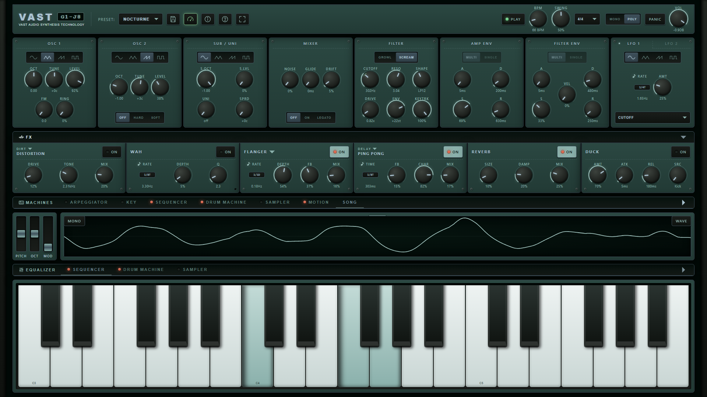
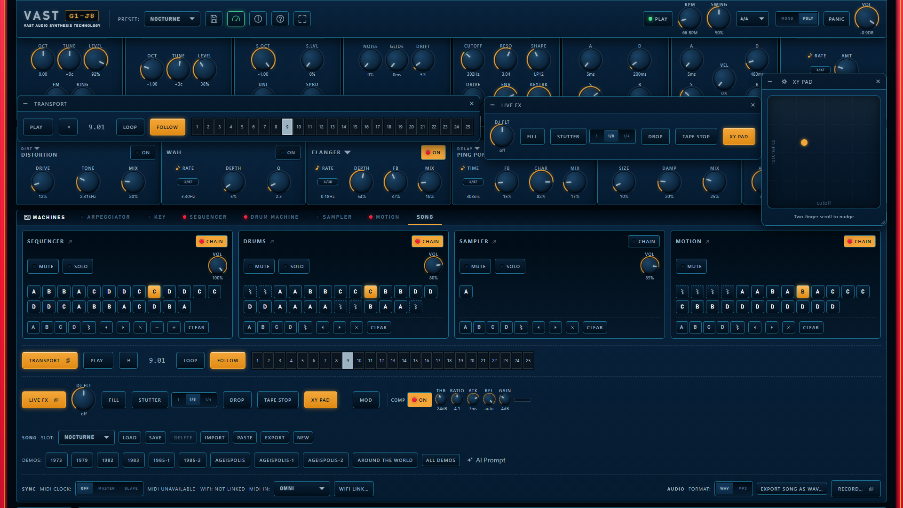
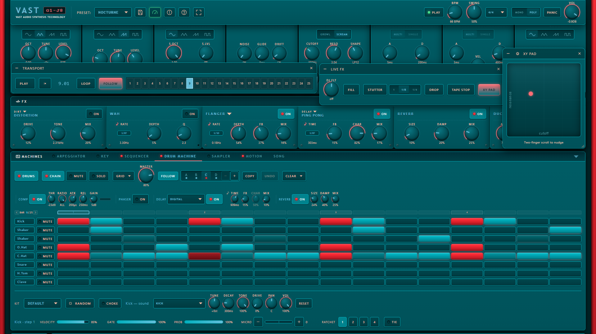
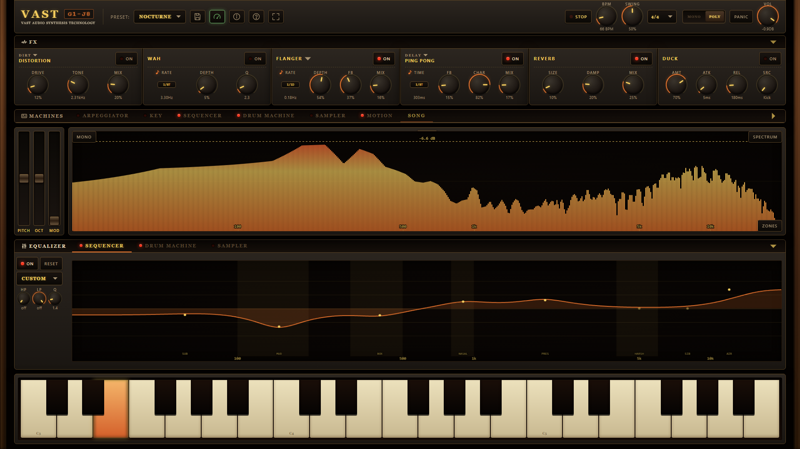
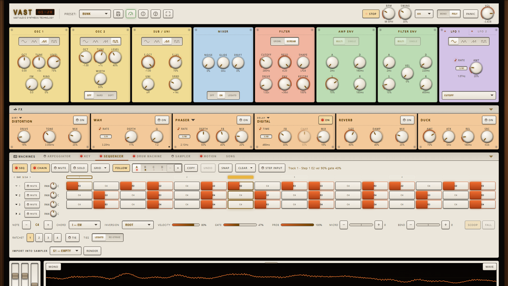
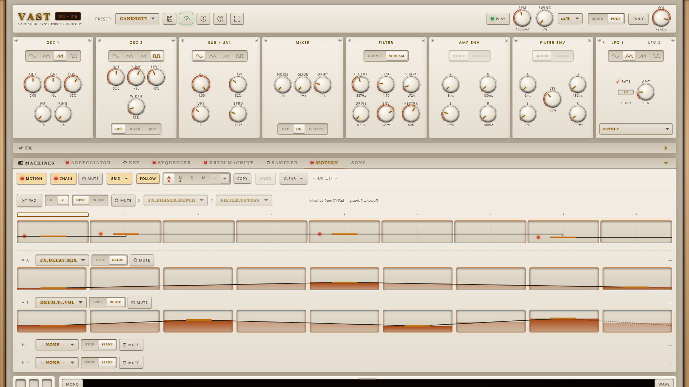
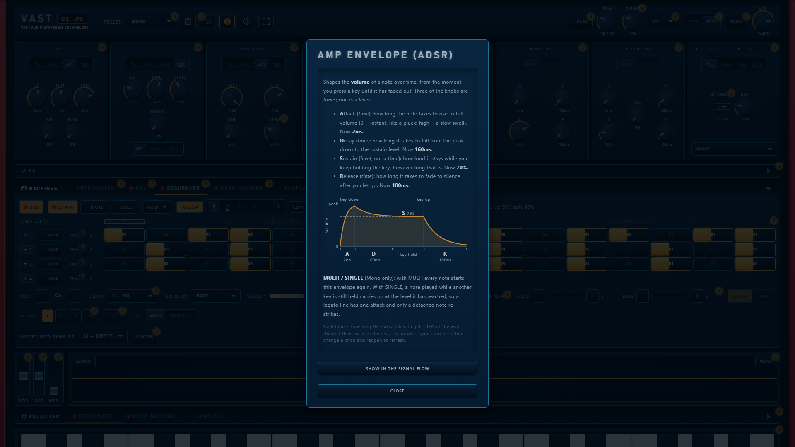
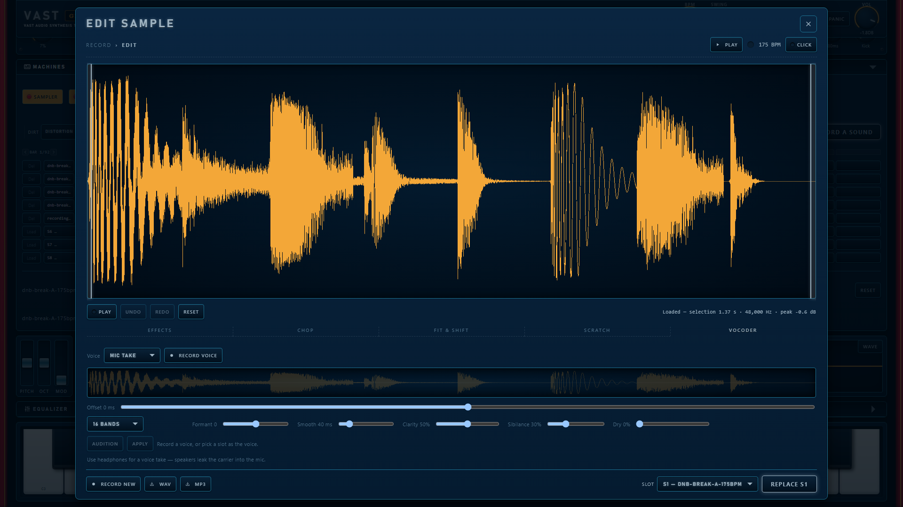
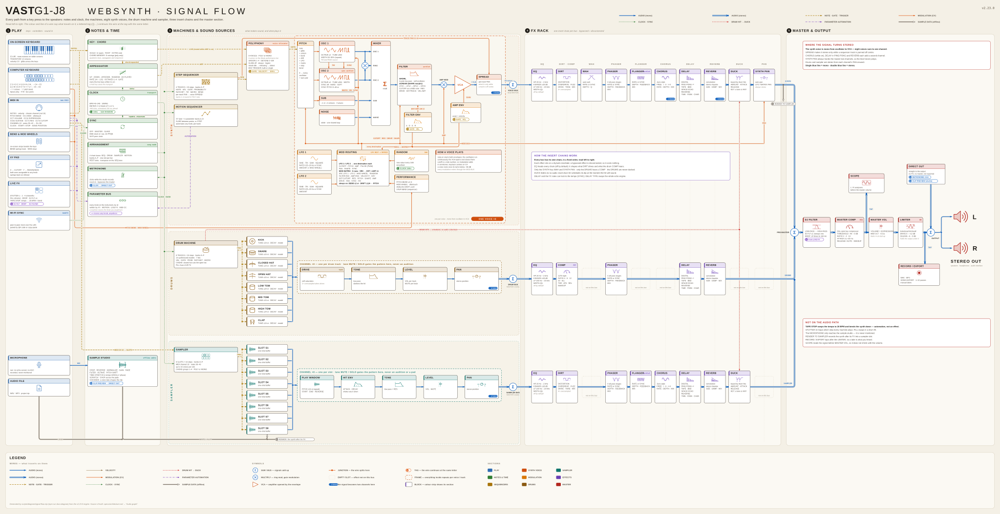

# WebSynth — VAST G1-J8

An open source browser-based polyphonic subtractive synthesizer — with a step-sequenced
drum machine and multi-track sampler — built on the Web Audio API.
Vanilla TypeScript + Vite, zero runtime dependencies.

<p align="center">
  <a href="https://vast.status201.com/">
    
  </a>
</p>

<p align="center">
  <strong><a href="https://vast.status201.com/">▶ Launch VAST G1-J8 in your browser →</a></strong><br>
  Free, as in Free Speech <em>and</em> Free Beer.<br>
  No install, no signup — open it and play.
</p>

<p align="center">
  <a href="https://vast.status201.com/">
    
  </a>
</p>

<p align="center">
  Make songs (arrangements) out of your sequencer, drum/motion machines and sampler lanes.<br>
  Share, save and load them using JSON files and zip project files when using sampler audio.<br>
  Or export as WAV/MP3.
</p>


<p align="center">
  <a href="https://vast.status201.com/">
    
  </a>
</p>

<p align="center">
  Eight synthesised drum voices, each with its own tune, decay, tone, drive, pan and volume, and a compressor, phaser, delay and reverb on the drum bus.<br>
  Every step carries its own velocity, gate, probability, micro-timing and ratchets.<br>
  Float the Transport, Live FX and XY pad windows over any tab: jump to any bar, punch in a fill, stutter or tape stop, or sweep two parameters at once — they spring back when you let go.
</p>

<p align="center">
  <a href="https://vast.status201.com/">
    
  </a>
</p>

<p align="center">
  A drawable 8-band EQ on each machine — sequencer, drum machine and sampler — with the problem zones the Spectrum names (mud, box, nasal, harsh) shaded on its graph.<br>
  See the problem, then fix it in one click with De-Mud, De-Box, De-Nasal or De-Harsh.<br>
  Want it all on one screen? Scale the interface from 50% to 150% in Settings; the keyboard grows extra octaves to fill the width.
</p>

<p align="center">
  <a href="https://vast.status201.com/">
    
  </a>
</p>

<p align="center">
  Four tracks per bank in the step sequencer: write a whole chord onto a step from the song's key, choose its inversion, and let any note scoop into its pitch or fall away from it.<br>
  Then render the bar into a sampler slot and layer the synth over itself.
</p>

<p align="center">
  <a href="https://vast.status201.com/">
    
  </a>
</p>

<p align="center">
  Eight looks — Classic, Vibrant, Dark, Light, Pastel, Jungle, Race and High contrast — or Auto to follow your system.<br>
  Pick one in Settings; it is kept per device.
</p>

<p align="center">
  <a href="https://vast.status201.com/">
    
  </a>
</p>

<p align="center">
  Every control that isn't obvious gets its own help badge: tap ⓘ, then any badge, for what it does and how to use it — and, for anything on the signal path, <strong>Show in the signal flow</strong> to see where it sits in the whole instrument.
</p>

<p align="center">
  <a href="https://vast.status201.com/">
    
  </a>
</p>

<p align="center">
  Record a sound from your mic, or open any sampler slot in the studio: trim it, add effects, and undo any step.<br>
  Chop a break into slices across the slots, fit it to the tempo or shift its pitch without changing its length, scratch it like a record — or sing or speak into the Vocoder and make the sample talk.<br>
  Then put it back in its slot, or save it as WAV or MP3.
</p>

## Signal flow

Every path from a key press to the speakers on one poster: the inputs, notes and
clock, the machines, the synth voice with its modulation, the drum and sampler
channels, the three insert chains and the master section. Open it on its own to
zoom in — or, in the app, open **Help & About → Explore the signal flow** to
click through it area by area.

<p align="center">
  <a href="docs/signal-flow-light.svg">
    <picture>
      <source media="(prefers-color-scheme: dark)" srcset="docs/signal-flow-dark.svg">
      
    </picture>
  </a>
</p>

## Features

### Sound

- **8-voice polyphony** (5 on the Weak performance tier) with mono/poly switching and glide
- **Dual oscillator** (sine/triangle/saw/square) + noise, per-osc octave/detune/level, and alias-free **pulse width** on the square
- **Oscillator sync**: OSC 2 locked to OSC 1, **hard** or **soft**; the SYNC knob sweeps the tone for the classic tearing lead
- **FM and ring mod**: OSC 1 modulates OSC 2's pitch (**FM**, also a mod-matrix destination, works with sync) and mixes in OSC 1 × OSC 2 (**RING**)
- **Sub oscillator** (one or two octaves down)
- **Unison** voice-stacking with detune spread (fat supersaw)
- **Oscillator drift / "Age"**: subtle analogue tuning instability
- **Glide modes**: off / always / legato (only when notes overlap)
- **Single or multi trigger, per envelope** (Mono): a legato line can keep its level and still re-sweep the filter
- **Two filter models**, level-matched so switching changes the character, not the volume:
  - **GROWL**: Moog-style 4-pole ladder with resonance and drive; warm and saturated, the bass thinning as resonance rises
  - **SCREAM**: a cleaner 4-pole ladder that **keeps its low end** at any resonance (the Prophet-600 trick), so the resonance screams over a full bottom, with a **SHAPE** knob morphing LP24 → LP12 → BP12 → HP24, which can itself be modulated
- **Filter key tracking**: timbre stays even up the keyboard, and a self-oscillating filter plays in tune
- **Two ADSR envelopes** (amp + filter), filter-envelope amount in semitones and a **VEL** knob for velocity-to-filter; their **ⓘ** badges draw the curve you have set, with its times, levels and the cutoff it reaches
- **Two LFOs**, routable to cutoff, pitch, amp, pulse width (PWM), **stereo pan** (an auto-panner), filter **shape** or oscillator **sync**
- **Mod matrix**: eight routes from either LFO, an envelope, the mod wheel, velocity, the note or a sample-and-hold **random**, each at its own **bipolar** depth; routes on one destination add up. Opens from **MOD** in the Song tab's Live FX row, in a window you can leave open while you play, and a modulated knob shows how far it can move (and, for the mod wheel, where it is now)
- **FX chain**: EQ → Dirt → wah → phaser → flanger → chorus → delay → reverb → duck, each bypassable:
  - **Dirt** (synth and sampler): DISTORTION, OVERDRIVE or FUZZ
  - **Flanger**: the jet sweep (RATE, DEPTH, FB, MIX)
  - **Chorus**: Juno-style, with fixed I / II / I+II modes; it shares the Phaser's panel with the flanger
  - **Delay** (synth, drums and sampler): DIGITAL, PING PONG, TAPE, BBD, SPACE ECHO or REVERSE, with a **CHAR** knob for each one's character; switching type lets the old echoes ring out
- **Equalizer, one per machine** (Sequencer, Drum Machine, Sampler): eight bands you **draw straight onto the graph**, real HP/LP filters, a Q from broad tone shaping to a narrow notch, and presets from Low Pass and Telephone to **De-Mud**, **De-Box**, **De-Nasal** and **De-Harsh**. It sits on the Spectrum's frequency scale, so a bump you can see is under the band that fixes it
- **Sidechain ducking**: the synth (and the sampler channel) pump with the drums. Pick the drum that keys it (**Kick**, or **Any**), how far, how fast and how long; it follows the pattern, ratchets and fills included, and ducks the reverb tail too. No threshold to set
- **Tempo lock**: every rate and delay-time knob (wah, phaser, flanger, delay and both LFOs, wherever they appear; the chorus stays free) has a **note glyph**; tap it and the knob becomes a division (`1/8`, `1/8 D`, `1/4 T`) that follows the BPM, or an incoming MIDI clock. Locking picks the nearest division, so the sound never jumps
- **Bus compressors** with gain-reduction meters: a 1176-style FET on the drum bus ("all buttons in" included) and an SSL-G-style VCA glue compressor on the master
- **Master limiter**, the last stage and on from the start: a lookahead brickwall that turns what used to be a hard clip into a smooth dip, live and in every export, and leaves anything that fits untouched. **DRIVE** for loudness, **CEIL** for headroom

### Sampler

- **Each slot is a full voice**: **pitch** ±2 octaves (varispeed), **trim** start and end, play **backwards**, **attack/decay**, a resonant **tone** filter, **pan** and level. Slots in one **choke group** cut each other, and a **mono** slot cuts its own previous hit
- **Record or load**: WAV/MP3, or the microphone in a full-screen studio with input meter, count-in, metronome and transport. Edit with crop, low/hi-pass, octave, reverse, normalize, fades, boost, fit, pitch-shift, scratch and vocoder (ten steps of undo); ✎ reopens any slot
- **Chop a break**: 2–8 slices, evenly or **at the transients**, drag the boundaries, then **spread** them across the slots in one undoable step
- **Scratch by drawing**: draw the record's speed over sixteenths at your tempo (below the line runs backwards) and cut with the crossfader lane. Start from a classic (baby, transformer, chirp, tear, flare, scribble, stab) or a random one, preview it, print it
- **Vocoder**: make a clip talk. **Record voice** against the clip (counted in, latency-corrected) or use another slot as the voice; shape it with Offset, Bands, Formant, Smooth, Clarity, Sibilance and Dry
- **Fit a loop to your tempo** without detuning it: **FIT** retimes a clip to the nearest bar in one press; the editor's **Fit** picks any length against the song's meter, **Rhythmic** for drums and loops, **Tonal** for pads. **Shift** does the opposite: pitch moves, length stays
- **Resampling**: **Import into sampler** renders the current sequencer bank through the synth and FX into a slot, as a bar-exact, seamless loop

### Sequencing

- **Transport**: clock, arpeggiator, **4-track** 16-step note sequencer (tracks 2–4 need poly voicing and have their own **PAN**), 8-track drum machine and 8-slot sampler. **Step Input** fills a bank by playing
- **Time signatures & polyrhythm**: **METER** beside BPM sets 3/4, 5/4, 2/4, 7/4, 5/8, 6/8, 7/8, 9/8 or 12/8, and the grids, accents, ruler and exports follow (5/4 and 7/4 at eighth-note resolution). Each machine has its own **LEN** and **RATE**: 12 steps against a 16-step bar, or triplets inside it. Swing follows each lane's own grid
- **Key, scale & chord tools**: a **KEY** tab snaps everything you play to a key, live (your notes stay as written; *chromatic* undoes it). An **Extra note** lets one outside note through: a blue note, a bebop passing tone. **Chord memory** turns one key into a diatonic chord (triad to 9th, sus, power), which the arp follows; **Chord ▾** writes a chord with any inversion across the four tracks; **Snap** makes the key permanent
- **Per-step settings**, drawn on the step buttons: velocity, gate, probability, ratchet (1–4), tie (sequencer: the note slides on without a new attack, with a song-wide RE-STRIKE option for older songs), **micro-timing** (±12 notches of 1/24 of a step) and, on sequencer steps, a **bend** of up to an octave as a scoop or a fall
- **Grid editing**: tap to toggle, **drag to paint** a run, **press-and-hold** (or right-click) to select a step without switching it off. **Clear ▾** wipes a bank or one row, or **shifts** it a step, with one-press Undo. A step switched off keeps its settings
- **Pattern banks**: 4 per machine (A–D), growing to 16 (A–P), each copyable and chainable
- **Song chains**: an arrangement per machine (`A A B A C A A D`), with **rest** bars, drag-to-reorder and, on the sequencer lane, a **transpose** per bar (`A+5`), so one bank becomes a progression
- **Motion sequencer**: per-bank automation, an XY lane driving the XY Pad's two parameters plus four single-parameter lanes (A–D), so one bank moves up to **six** parameters. Each lane **slides** or **steps**, shows the value you are setting, folds away when empty and has its own **mute**, which another lane can automate. Everything it moves returns to where you left it on Stop
- **Drum kits**: each of the 8 tracks picks its voice (the eight classics plus **Conga, Bongo, Cowbell, Clave and Shaker**) from **kit presets**, **randomize** or per track; an optional **hat choke** lets a closed hat cut an open one

### Performance

- **Live DJ FX**: momentary Fill, Stutter (1 / 1/8 / 1/4), Filter Drop, Tape Stop and a bipolar DJ Filter (LP ← → HP), in the Song tab and in a floating **LIVE FX** window reachable from every tab
- **XY Pad**: a Kaoss-style controller in a movable window; each axis drives **any** parameter (default cutoff × resonance) and springs back on release, so it colours a moment without editing the patch. Drag its corner to make it up to four times bigger; its assignment saves with the song
- **Input**: on-screen keyboard (3 octaves, up to 6 on an ultrawide), computer keyboard (QWERTY, AZERTY, QWERTZ or Dvorak) and Web MIDI with velocity, pitch bend, mod wheel, aftertouch, **sustain pedal** (also an arp latch), **expression** (CC11) and volume/cutoff/resonance CCs. **Channel 10 plays the sampler** (pads from C1), and a **MIDI in** picker chooses the synth's channel
- **Transport sync (MIDI + WiFi)**: one **Master**, one **Slave**, over MIDI clock (USB or any cable) or over **WiFi** with no cable and no server (pair by QR code or link). A slave joins mid-song at the right bar and rides out dropouts. The **Ageispolis-1** and **-2** demos are a matched pair to try it with
- **Oscilloscope / spectrum** (mono or stereo, peak-hold): a log-frequency spectrum you can hover for the exact frequency, with **Zones** shading mud, boxy, nasal and harsh
- **Pitch-bend and mod wheels**

### Songs, sounds & sharing

- **Songs**: save and load whole songs (every setting, bank and chain) as compact `.json` files or browser slots. A shelf of demos, with a **demo library** of each one's tempo, length and notes; drop a song or project file into `src/state/demos/` to add one
- **Project export**: **Song (.json)** or **Project (.zip)**, which carries every loaded sample (WAV or MP3) so a sampled song travels as one file. Import takes either
- **Presets**: 25 factory sounds across basses, keys, pads, leads and plucks, plus your own. **ember**, **vellum** and **prism** show off the SCREAM filter; **tines**, **chime**, **growl**, **clang** and **tear** show off FM, ring mod and sync. The **Preset** manager saves, exports a sound or a bank of what you have changed, deletes, restores factory sounds, and imports with a review step (new / identical / clashing)
- **Share links**: Export → **Copy Link** puts the whole song in the URL, which never reaches a server; `#songUrl=` loads a hosted file
- **Generate songs with AI**: **✨ AI Prompt** gives you a ready-to-paste prompt (add your idea in *Describe your song*) for a finished track with sections and an ending. **Paste** takes the reply as-is, chat chatter and code fences included, and shows what it found before applying; dropping a file on the window works too
- **Formats for tools and agents**: a published [JSON Schema](public/schema/websynth-song.schema.json) for songs, a compact [authoring dialect](public/schema/websynth-song-author.schema.json) an LLM can write in ~40 lines (`"A2"`, `"kick": [0,4,8,12]`, `"AABA"`), and the full parameter list as [`/params.md`](public/params.md) and [`/params.json`](public/params.json). See **Formats & schemas** below
- **MCP server**: AI tools can fetch the formats, validate, expand, save and share-link songs and presets, locally or hosted at `https://vast.status201.com/mcp`. See **MCP server** below

### App

- **Performance mode**: Weak / Medium / Strong or Auto, trading latency, polyphony and effect cost to keep the audio glitch-free on slow devices
- **UI themes**: Classic, Vibrant, Dark, Light, Pastel, Jungle, Race and High contrast (7:1 or better), or Auto to follow the system
- **UI size**: 50% to 150%, phones and tablets included
- **Install it as an app**: works **offline** (**Play offline** in Help & About saves everything on the device), launches fullscreen on Android, **keeps the screen awake while the audio runs**, opens song files directly (desktop) and plays with the iPhone mute switch on (iOS 17+)
- **Your work survives a reload**: each tab autosaves its session, its samples included
- **Restore to Factory Settings** in Help & About wipes everything VAST stored on the device and fetches a fresh offline copy
- **Problem reports without a console**: Help & About ▸ Debug shows the last errors, and **Copy report** / **Share report** send them on

## Controls

- **Computer keyboard**: `z s x d c v g b h n j m ,` = lower octave,
  `q 2 w 3 e r 5 t 6 y 7 u i` = upper octave
- **`-` / `=`** (the two keys right of 0, or numpad `-` / `+`): shift keyboard octave
- **Tab** onto any knob, then the arrow keys turn it (Shift = fine, Page Up/Down = big steps, Home/End = min/max, Delete = reset)
- **`'` / `/`**: pitch bend up / down — the keys are stacked, so up really is
  the upper one (springs back on release)
- **Space**: transport play / stop
- **Shift + Space**: pause / continue from where you paused
- **Shift + L**: loop on / off
- **Home**: move the playhead back to bar 1
- **Shift + Arrow Left/Right**: move the playhead one bar back / forward
- **F** (hold): drum fill (on Dvorak, where F is a note key, it is the key that types U: the same spot on the board)
- **Shift + R**: open / close the Record window (its level meter turns red if the take clips)
- **Drum and sampler grids**: **Tab** into a grid, move with the **arrow keys**, **Enter** toggles the step (Space still plays and stops)
- **Esc**: panic (all notes off)
- While a **dialog** is open the keys are its own: Esc closes it (the top one, if two are stacked) and the shortcuts above wait until it closes
- **?**: show / hide the info badges — the ⓘ markers that explain a control where
  it sits, rather than in a manual
- **Playhead ruler**: the strip above every step grid — click a tick to move the
  playhead there (mid-play it jumps in time; stopped it sets where Play starts).
  The Song tab adds a bar-by-bar scrubber for the whole arrangement, a
  **Play / Pause** that continues where you paused (the header's Stop still goes
  back to the start), a **Loop** — switch it on, click the first and last bar,
  and the transport repeats them, changing over on the bar line — a **Follow**
  switch that keeps the playing bar in view (off, you can scroll a long song
  freely) — and a **TRANSPORT** button that floats all of it over any tab, in a
  window you can drag wider to see more bars
- **METER** (beside BPM): the song's time signature — every machine follows it.
  Each machine's own **GRID** pair (**LEN** / **RATE**) sits in its header: LEN
  on *BAR* follows the meter, anything else pins a step count and sets that lane
  against the bar on purpose
- **Double-tap a knob**: reset it to the loaded preset/song's value (or the
  factory default if none set it); Shift-drag for fine adjustment
- **Step grids** — tap: toggle a step · drag across cells: paint them on/off in
  one gesture · press-and-hold (or right-click): select a step to edit without
  toggling it · **Delete** / **Backspace**: clear the selected step
- **Motion pads** — drag: set the value, snapped to steps of 0.05 so two lanes
  can be given exactly the same one · Shift-drag: fine, unsnapped ·
  press-and-hold: read a value without changing it · double-click: clear. The
  value shows in each lane's header readout and in a bubble while you drag
- **Chain chips** (Song tab) — tap: select a bar · drag: move it, dropping into
  the gap the line marks · **◀** / **▶**: move it one place · **✕**: remove it ·
  on the sequencer lane, wheel over a chip (or **−** / **+**): transpose that
  bar a semitone · double-click: back to `+0`
- **Ctrl/Cmd+Z**: undo the last grid edit on the machine tab you are looking at

## Running

```bash
npm install
npm run dev          # vite dev server, --host (open the printed URL)
npm run build        # tsc typecheck + vite production build to dist/
npm run preview      # serve the production build
npm run typecheck    # the primary gate: strict + noUncheckedIndexedAccess + no unused code

# Tests — there is no linter
npm test             # vitest run — unit tests (node; jsdom for tests/ui/**)
npm run test:watch   # vitest in watch mode
npm run e2e          # playwright run — browser end-to-end tests (Chromium)
npm run e2e:ui       # playwright's interactive UI runner
npm run e2e:chrome   # the same suite against installed Chrome (pw-chrome.config.ts)

# Specs and generated files. The three checks run in CI too — check:demos and
# check:params in the `unit` job, spec:lint in the SDD workflow.
npm run spec:lint    # spec structure, the README/ADR indexes, REQ slug ids + citations + code names
npm run gen:params   # regenerate public/params.{json,md} from the live registry
npm run check:params # fail if a parameter was added without regenerating
npm run clean:demos  # rewrite src/state/demos/ to canonical form + reindex
npm run check:demos  # fail if the demo index drifted
                     # (prebuild runs clean:demos + gen:params automatically)

# Build budget and CSS (CI's build job runs check:bundle after the build)
npm run check:bundle        # fail if the entry chunk is over 500 kB (run after build)
npm run cascade:fingerprint # snapshot computed styles, to prove a CSS move changed nothing
npm run cascade:conflicts   # list rules whose winner depends on stylesheet load order

# Sound work — nothing automated can judge this; see ADR-010
npm run bench:audio                        # render takes through the real engine, to listen to
npm run bench:metrics -- bench/take.wav    # measure a rendered take (--compare a/b for A/B)

# Cost — audio thread and main thread, in Chromium (runtime-performance.md)
npm run bench:perf                         # twelve fixed scenarios; --name saves a run, --compare a b diffs two

# MCP server (see MCP server below)
npm run start:mcp:http # serve the HTTP transport on 127.0.0.1:8787
npm run build:mcp      # rebuild the song-core bundle it imports
npm run pack:mcp       # mcp-v<version>.zip for deploying it, without a release

npm run release      # cut a versioned release (see Releasing below)
```

Audio is silent until it is deliberately faded up, and **"Tap to start" appears
only when your browser needs it** — many require a user gesture before an
`AudioContext` may make sound, and where yours does not, the synth just starts.
The MIDI permission prompt still waits for the first thing you touch either way.

## Formats & schemas

Everything VAST reads or writes is a documented JSON format with a published
draft 2020-12 JSON Schema. The schemas ship in the build, so they are fetchable
from the running site (`/schema/…`) as well as from this repo.

| Format | Ver | Schema | Spec | What it is |
| --- | --- | --- | --- | --- |
| `websynth-song` | 9 | [song](public/schema/websynth-song.schema.json) | [song-mode](specs/features/song-mode.md) | The canonical song the app exports |
| `websynth-song-author` | 1 | [song-author](public/schema/websynth-song-author.schema.json) | [song-authoring-dialect](specs/features/song-authoring-dialect.md) | The compact dialect an AI writes — input only |
| `websynth-preset` | 1 | [preset](public/schema/websynth-preset.schema.json) | [preset-authoring](specs/features/preset-authoring.md) | One sound |
| `websynth-preset-bank` | 1 | [bank](public/schema/websynth-preset-bank.schema.json) | [presets](specs/features/presets.md) | Many sounds in one file |

Song versioning is **additive** — a bump only ever adds optional fields or widens a
range (v8 and v9 raised the bank count), so every version from v1 up still loads and there is no migration step (see
[ADR-007](specs/decisions/adr-007-songfile-additive-versioning.md)).

The **parameter list** is deliberately not written into any of those schemas —
it grows with the synth, so a hand-copied list would go stale. It is generated
from the live registry instead and published as two files:

| File | For |
| --- | --- |
| [`/params.md`](public/params.md) | Reading — the prose table, split into sound vs song-only parameters |
| [`/params.json`](public/params.json) | Programmatic use — the same list plus `taper`, `curve`, `unit` and a `patch` flag |
| [`/llms.txt`](public/llms.txt) | The agent entry point: formats, versions, dimensions, and links to all of the above |

Regenerate them with `npm run gen:params` (it also runs in `prebuild`);
`npm run check:params` fails CI if a parameter was added without it. Details in
[param-catalogue](specs/features/param-catalogue.md).

## MCP server (songs and sounds from AI agents)

A zero-dependency MCP server (hand-rolled JSON-RPC — no SDK) that gives
tool-using AI agents a full authoring loop. It runs two ways: **hosted**, which
needs nothing installed, or **locally over stdio**, which adds the two tools
that write files.

### Hosted — nothing to install

```bash
claude mcp add --transport http websynth https://vast.status201.com/mcp
```

Or in Claude.ai: **Settings → Connectors → Add custom connector**, same URL. No
account, no token, no clone — it is authless and read-only, because every tool
below except the two `save_*` ones is a pure function over a public document
format. `make_share_link` is how you get the result back: a URL that opens the
song in the synth.

**Discovery**: `get_params` returns the whole parameter catalogue as structured
JSON — ranges an agent can compute against, rather than the prose table the two
format guides embed.

**Songs**: `get_song_format` (the live parameter table + the compact authoring
dialect), `validate_song` (field-level errors the agent can fix), `expand_song`,
`save_song` (writes an importable `.websynth.json`), and `make_share_link` (a
`#song=` URL). `read_midi` reads a `.mid` and returns what arranging it needs:
tempo, meter, each channel's instrument and range, the grid every note fits (and
so how many bars one bank can hold), which bars repeat, and a bar-by-bar step
listing. Hosted, send the file as `base64`; locally it also takes a `path`. Absolute URLs — share links and the schema links the guides cite —
are built from `WEBSYNTH_BASE_URL`, which defaults to the published site; point it
at `http://localhost:5173` to work against a dev server.

**Presets**: `get_preset_format` (the sound-only parameter table plus
sound-design notes), `validate_preset` (invented parameter ids and out-of-range
values are real errors here, where a file import reports the same findings as
**warnings** — an author wants the file refused, an importer wants it to load),
`expand_preset` (a
sparse authored patch → the complete sound, so nothing leaks in from whatever
was loaded before) and `save_preset` (writes a `.preset.websynth.json` or, for
several sounds, a `.bank.websynth.json`). See
[`specs/features/preset-authoring.md`](specs/features/preset-authoring.md).

### Locally over stdio — adds the write tools

`save_song` and `save_preset` exist only here. They write into the server's
working directory, which is your checkout locally and would be a directory no
caller can reach on a shared host, so the hosted profile omits them
([ADR-020](specs/decisions/adr-020-remote-mcp-is-authless-and-read-only.md)).

After `npm install` the server self-builds its song-core bundle on first run —
no other setup. **Claude Code** picks it up automatically from the committed
[`.mcp.json`](.mcp.json). For other MCP clients, register:

```json
{
  "mcpServers": {
    "websynth": {
      "command": "node",
      "args": ["scripts/mcp/websynth-mcp.mjs"],
      "cwd": "<path to this repo>"
    }
  }
}
```

To run the HTTP transport yourself — against a fork, or to try a change before
deploying it — `npm run start:mcp:http` serves it on `127.0.0.1:8787`. Hosting
it publicly is in [DEPLOYMENT.md](DEPLOYMENT.md#hosting-the-mcp-server).

See [`specs/features/mcp-server.md`](specs/features/mcp-server.md).

## Releasing

`npm run release -- <version|major|minor|patch>` bumps `package.json`, promotes
the CHANGELOG `[Unreleased]` section, builds the app, and zips `dist/` into
`dist-v<version>.zip` — plus `mcp-v<version>.zip`, the deployable MCP server —
then **prints** the `git` and `gh release create`
commands to publish (it never touches git/GitHub itself). Use `--dry-run` to
preview, `--yes` to skip the prompt, `--skip-build` to skip the build + zips.
Attaching them needs the [`gh` CLI](https://cli.github.com/) authenticated.
See **[DEPLOYMENT.md](DEPLOYMENT.md)** for the full flow and how to deploy the
built `dist/`.


## Troubleshooting

- **No sound on Bluetooth speakers (Windows).** If VAST goes quiet after
  another tab or app played audio, while the scope still moves, switch the
  speaker off and on (or reconnect it in Windows). It is a Windows Bluetooth
  issue that silences live browser audio in every browser; reloading VAST does
  not help.

## Project layout

```
src/
  main.ts            boot: create Engine + ParamBus, mount UI, wire input
  audio/             AudioContext graph
    engine.ts        AudioContext owner: graph wiring, param subscriptions, transport
    engine-params.ts the voice and machine param binders engine.ts calls (their order is boot order)
    osc-pair-policy.ts  decides when FM / oscillator sync put a voice on the sync pair
    lifecycle.ts     context start/resume: verified + retried resume, gesture re-arm, the click-free fade
    background-watchdog.ts, media-session.ts, ios-audio-session.ts
                     keeping a hidden page's audio alive (or suspending it when it breaks up)
    polyphony.ts     voice pool + note allocation (poly/mono, unison, glide, drift)
    lane-mixer.ts    Song-tab mute / solo / volume across seq / drum / sampler
    voice.ts         one voice: 2 osc + noise → filter (GROWL/SCREAM) → amp
    oscillator.ts, envelope.ts, lfo.ts, pwm.ts, midi.ts
    frequency-line.ts  the note-by-note frequency + glide curve, shared by oscillators and the sync pair
    sync-osc/        AudioWorklet wrapper + engagement crossfade for oscillator sync
    cross-mod.ts     ring mod + linear FM (OSC 1 modulating OSC 2), engaged only while in use
    mod-matrix.ts    the six free modulation routes, each a GainNode into an AudioParam
    tempo-bind.ts    resolves a rate/time param against its tempo lock + BPM
    metronome.ts     the sample studio's beat source + click (straight to the speakers, never recorded)
    ladder-filter/   AudioWorklet wrapper — hosts both filter models (worklet in public/worklets/)
    compressor/      AudioWorklet wrapper for the 1176/SSL bus compressor
    limiter/         AudioWorklet wrapper for the master limiter
    effects/         eq, dirt, wah, phaser, flanger, chorus, delay, reverb, ducker, compressor, limiter
    drums/           drum synthesis
    transport/       clock, arpeggiator, sequencer, drum-machine, sampler, motion,
                     arrangement (chain lanes), transport loop, performance (live DJ FX),
                     sync/ (transport sync: the master/slave core, plus the MIDI and
                     WiFi (WebRTC) transports and their signalling)
    recorder/        mic capture, pure sample DSP (chop, time-stretch, scratch, vocoder), WAV/MP3 encode,
                     AudioWorklet sink (song export + record-a-sound), clip preview, offline renders
  state/
    params.ts        ParamBus + all parameter definitions
    patterns.ts      PatternStore: the live seq / drum / sampler / motion banks
    pattern-model.ts the step and track types, machine constants, factories and clamps
                     (re-exported by patterns.ts)
    meter.ts         the bar, the grid and each lane's window (see specs ADR-019)
    preset.ts        factory bank + localStorage persistence
    preset-file.ts   preset/bank file build, parse + import planning (pure)
    song.ts          full-song build/apply + localStorage slots + the demo list
    song-validate.ts, song-version.ts, serialize.ts
                     checking, versioning and compacting a song file
    song-author.ts   the compact dialect an AI writes, expanded to a song
    midi-file.ts     the Standard MIDI File reader (MCP read_midi)
    project.ts       project-zip bundle (song.json + sampler clips) build/parse
    limits.ts        every bound on untrusted input, in one place
    edit-history.ts  the sample studio's bounded undo/redo stack
    demos/           drop-in *.json SongFiles / *.websynth.zip projects,
                     found at build time, fetched when clicked
    perf-mode.ts     performance-mode preference + device-tier detection
    theme.ts         UI theme registry + the stored choice (applied pre-paint by public/theme-boot.js)
    ui-scale.ts      UI zoom stops + the stored choice (applied pre-paint by the same script)
    tempo-lock.ts    which knobs can be locked to the grid, and in what unit
    prefs.ts         the one try/catch around device-local preferences in localStorage
  utils/             dependency-free helpers importable from any layer: zip codec,
                     deflate-raw streams, param tapers, scale/chord theory,
                     BPM<->note-division math, the ADSR curve, wake lock, the offline copy
  platform/          iOS / Android detection (separate from the device-tier guess in perf-mode.ts)
  types/             ambient declarations (the build-stamped version and build id, the PWA types)
  vendor/            lamejs, qr, jsqr: vendored, not npm packages (see specs ADR-003)
  ui/                hand-built DOM, no framework
    app.ts           assembles the page from the regions in shell/ and panels/
    studio-api.ts    the UI's narrow view of the Engine (see specs ADR-009)
    shell/           header, pattern row, play button, scope panel, bottom column
    panels/          synth, FX rack, EQ and one panel per machine. song-panel.ts keeps the
                     DOM (DJ FX, chain lanes) while song-session.ts holds the loaded song,
                     song-io.ts imports/exports it and demo-loader.ts is the one door for demos
    components/      reusable controls (knob, dropdown, modal, floating window, …) and
                     the sample studio: record-sound-modal.ts frames record-screen.ts,
                     studio-waveform.ts, studio-tools.ts (four of the tool tabs), studio-vocoder.ts
                     (the Vocoder tab and its voice take) and studio-transport.ts
    onboarding/      the guided tour, the info badges and the in-app help text (help-content.ts)
    signal-flow/     the zoomable signal-flow map: camera (view maths), zones (the manifest's
                     walks), the map, its dialog, open.ts (the lazy door) and help-links.ts
    styles/          CSS Modules (*.module.css — each one a single @layer block, so
                     import order never decides which wins; see specs css-cascade-layers)
  styles/            Global CSS: layers.css (the cascade layer order), base.css (reset),
                     theme.css (custom properties), themes/*.css (one block per other theme),
                     layout.css (.app grid + responsive)
public/              static files served as-is: sw.js (offline), theme-boot.js, the schemas,
                     params.{json,md} and llms.txt (generated), icons
public/worklets/     ladder-filter.js, compressor.js, limiter.js, recorder.js, sync-osc.js, flanger.js, reverse-delay.js (audio thread)
specs/               the architecture: architecture.md, features/, recipes/, decisions/ (ADRs)
docs/                the signal-flow poster (light + dark SVG) and its zone manifest — generated
scripts/             build and dev tooling: release, benches, generators, spec-lint, sdd-guard,
                     css-cascade/, diagram/ (the signal-flow poster) and mcp/ (the MCP server)
tests/               Vitest unit tests, mirroring src/ (outside src/ on purpose)
e2e/                 Playwright end-to-end specs (configs at the root: playwright.config.ts, pw-chrome.config.ts)
```
